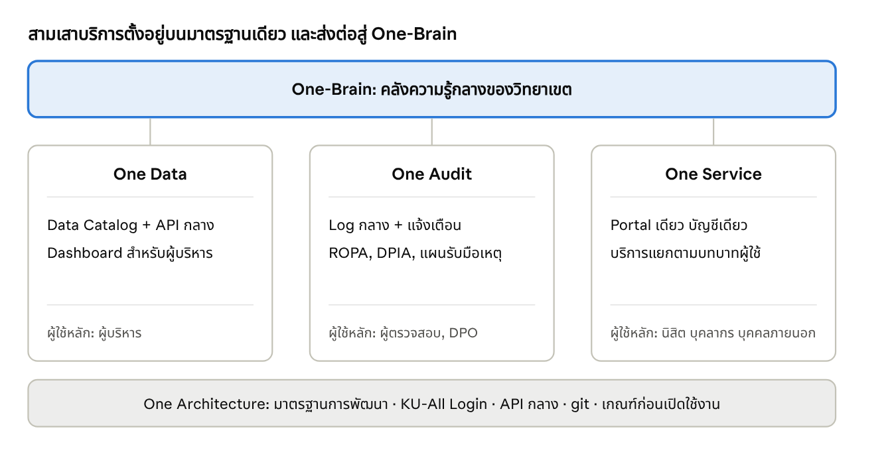
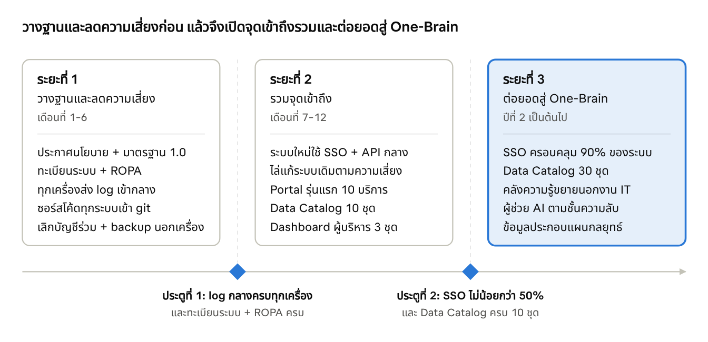

# CSC-ONE

นโยบายการบริหารจัดการเทคโนโลยีดิจิทัลและข้อมูลของ มหาวิทยาลัยเกษตรศาสตร์ วิทยาเขตเฉลิมพระเกียรติ จังหวัดสกลนคร

**สถานะ:** ร่างเพื่อเสนอผู้บริหารพิจารณา (20 พฤศจิกายน 2569)

> ทุกบริการเข้าถึงได้จากจุดเดียว ทุกข้อมูลมีที่มาและมีเจ้าของ ทุกการเข้าถึงตรวจสอบได้ สู่สมองกลางขององค์กร

## องค์ประกอบ

| เสา | สาระสำคัญ |
| --- | --- |
| **One Architecture** | ฐานของทุกเสา: มาตรฐานการพัฒนา KU-All Login API กลาง git และเกณฑ์ก่อนเปิดใช้งาน |
| **One Audit** | Log กลาง การแจ้งเตือน ROPA DPIA และแผนรับมือเหตุ |
| **One Service** | Portal เดียว บัญชีเดียว บริการแยกตามบทบาทผู้ใช้ |
| **One Data** | Data Catalog API กลาง และ Dashboard สำหรับผู้บริหาร |
| **One-Brain** | เป้าหมายปลายทาง: คลังความรู้กลางของวิทยาเขต |

## เอกสาร

| ไฟล์ | เนื้อหา |
| --- | --- |
| [policy/CSC-ONE-policy.md](policy/CSC-ONE-policy.md) | ร่างนโยบายฉบับเต็ม 11 หัวข้อ |
| [policy/CSC-ONE-policy.docx](policy/CSC-ONE-policy.docx) | ร่างนโยบายรูปแบบ Word |
| [docs/analysis.md](docs/analysis.md) | บทวิเคราะห์จุดเด่น จุดด้อย ความเป็นไปได้ และโอกาส |
| [docs/decisions.md](docs/decisions.md) | บันทึกการตัดสินใจและเรื่องที่ยังรอตัดสิน |
| [images/](images/) | แผนภาพโครงสร้างและแผนดำเนินงาน |

## แผนดำเนินงาน

ต้นฉบับที่แก้ไขได้อยู่ใน Claude Docs ไฟล์ในที่นี้เป็นสำเนา ณ วันที่ระบุ
