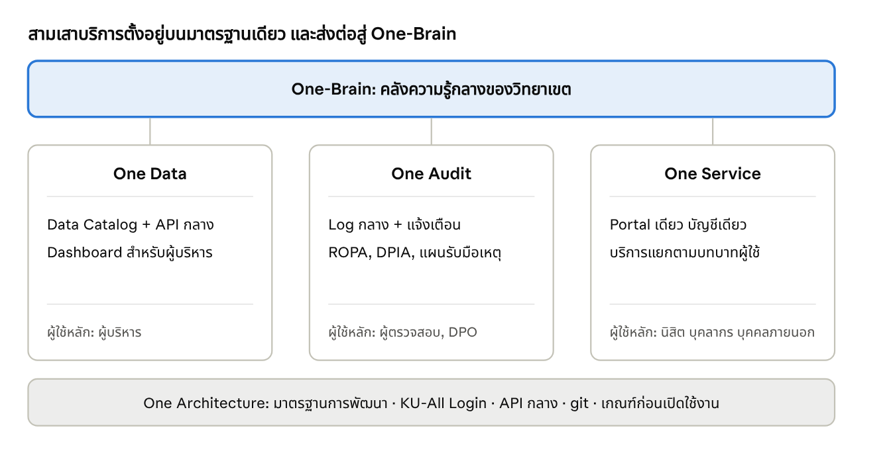
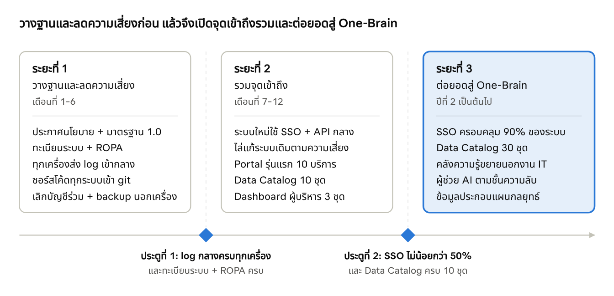

# CSC-ONE: นโยบายการบริหารจัดการเทคโนโลยีดิจิทัลและข้อมูลของวิทยาเขต

มหาวิทยาลัยเกษตรศาสตร์ วิทยาเขตเฉลิมพระเกียรติ จังหวัดสกลนคร

ร่างวันที่ 20 พฤศจิกายน 2569

**สถานะ:** ร่างเพื่อเสนอผู้บริหารพิจารณา

นโยบาย CSC-ONE กำหนดให้บริการและข้อมูลสารสนเทศทั้งหมดของวิทยาเขตเข้าถึงได้จากจุดเดียว ตรวจสอบได้ และพัฒนาภายใต้มาตรฐานเดียวกัน เพื่อเป็นฐานของคลังความรู้กลางของวิทยาเขต (One-Brain)

> **วิสัยทัศน์:** ทุกบริการเข้าถึงได้จากจุดเดียว ทุกข้อมูลมีที่มาและมีเจ้าของ ทุกการเข้าถึงตรวจสอบได้ สู่สมองกลางขององค์กร

นโยบายประกอบด้วย 4 เสาหลักบนฐานเดียวกัน ได้แก่ One Architecture, One Audit, One Service และ One Data โดยมี One-Brain เป็นเป้าหมายปลายทาง

## 1. หลักการและเหตุผล

ระบบสารสนเทศของวิทยาเขตพัฒนาแยกกันตามความต้องการของแต่ละหน่วยงานมาเป็นเวลาหลายปี จึงมีหลายเทคโนโลยี หลายช่องทางเข้าใช้ และหลายฐานข้อมูลที่เก็บข้อมูลเดียวกันซ้ำซ้อน สภาพนี้ส่งผล 4 ด้าน:

1. **ผู้บริหารไม่มีข้อมูลภาพรวมที่ทันเวลา** ต้องขอรายงานจากหลายหน่วยงานและตัวเลขไม่ตรงกัน
2. **ตรวจสอบย้อนหลังได้ยาก** log การเข้าถึงกระจายอยู่ตามเครื่อง ไม่เพียงพอต่อการตรวจสอบภายใน การปฏิบัติตาม PDPA และการรับมือเหตุภัยไซเบอร์
3. **ผู้ใช้บริการต้องจำหลายที่หลายรหัส** นิสิต บุคลากร และบุคคลภายนอกไม่ทราบว่าบริการอยู่ที่ใด
4. **ความเสี่ยงด้านความมั่นคงปลอดภัยสูง** ระบบที่พัฒนาโดยไม่มีมาตรฐานกลาง ใช้ซอฟต์แวร์ที่หมดอายุการสนับสนุน และใช้บัญชีร่วมกัน เป็นช่องทางให้เกิดเหตุบุกรุกได้จริง

ปัจจุบันวิทยาเขตมีองค์ประกอบพื้นฐานอยู่แล้ว ได้แก่ มาตรฐานการเชื่อมต่อระบบยืนยันตัวตนกลาง KU-All Login, API Gateway กลาง (api.csc), ระบบเฝ้าระวังและแจ้งเตือนกลาง, Dashboard พลังงานสำหรับผู้บริหาร และคลังความรู้ด้านเทคโนโลยีสารสนเทศ นโยบายนี้จึงเน้นการร้อยองค์ประกอบเหล่านี้เข้าด้วยกันภายใต้กรอบเดียว มากกว่าการสร้างระบบใหม่ทั้งหมด

## 2. วัตถุประสงค์

1. เพื่อกำหนดมาตรฐานกลางในการพัฒนา จัดหา และดูแลระบบสารสนเทศของวิทยาเขต
2. เพื่อให้การเข้าถึงระบบและข้อมูลทุกครั้งมีหลักฐานตรวจสอบได้ รองรับการตรวจสอบภายใน การปฏิบัติตาม PDPA และการรับมือเหตุภัยไซเบอร์
3. เพื่อให้นิสิต บุคลากร และผู้รับบริการเข้าถึงบริการสารสนเทศได้จากจุดเดียวด้วยบัญชีเดียว
4. เพื่อให้ผู้บริหารมีข้อมูลที่ถูกต้อง ทันเวลา และมีแหล่งที่มาชัดเจน เพื่อประกอบการตัดสินใจ
5. เพื่อสะสมความรู้ขององค์กรไว้ในคลังกลาง ไม่ให้สูญหายเมื่อบุคลากรเปลี่ยนแปลง และพร้อมต่อยอดสู่การใช้ปัญญาประดิษฐ์อย่างปลอดภัย

## 3. คำนิยาม

| คำ | ความหมาย |
| --- | --- |
| วิทยาเขต | มหาวิทยาลัยเกษตรศาสตร์ วิทยาเขตเฉลิมพระเกียรติ จังหวัดสกลนคร |
| คณะทำงาน CSC-ONE | คณะทำงานที่ผู้บริหารวิทยาเขตแต่งตั้งเพื่อกำกับดูแลนโยบายนี้ |
| งานเทคโนโลยีสารสนเทศ | หน่วยงานที่รับผิดชอบโครงสร้างพื้นฐานและระบบสารสนเทศกลางของวิทยาเขต ประกอบด้วย 3 หน่วยด้านล่าง |
| หน่วยบริการคอมพิวเตอร์และเครือข่ายอินเทอร์เน็ต | ดูแลเครือข่ายวิทยาเขต อินเทอร์เน็ต Wi-Fi และบริการคอมพิวเตอร์ผู้ใช้ |
| หน่วยโสตทัศนูปกรณ์ | ดูแลอุปกรณ์โสตทัศน์ในห้องเรียน ห้องประชุม และงานบันทึก/ถ่ายทอดสด |
| หน่วยพัฒนาโปรแกรม | พัฒนาระบบสารสนเทศ ดูแลเครื่องแม่ข่าย ฐานข้อมูล ความมั่นคงปลอดภัยไซเบอร์ และ firewall ที่กั้นระหว่างกลุ่มเครื่องแม่ข่ายกับเครือข่าย |
| ระบบสารสนเทศ | เว็บไซต์ แอปพลิเคชัน ฐานข้อมูล และบริการอิเล็กทรอนิกส์ที่ใช้ในการดำเนินงานของวิทยาเขต ไม่ว่าพัฒนาเอง จ้างพัฒนา หรือใช้บริการภายนอก |
| เจ้าของระบบ (System Owner) | หน่วยงานที่ใช้และรับผิดชอบกระบวนงานของระบบนั้น |
| เจ้าของข้อมูล (Data Owner) | หน่วยงานที่มีอำนาจตัดสินใจเรื่องความถูกต้อง การเปิดเผย และสิทธิ์เข้าถึงของชุดข้อมูล |
| ผู้ดูแลข้อมูล (Data Steward) | บุคลากรที่เจ้าของข้อมูลมอบหมายให้ดูแลคุณภาพและคำอธิบายของชุดข้อมูล |
| บัญชีเดียว (Single Sign-On) | การยืนยันตัวตนผ่าน KU-All Login ด้วยบัญชีมหาวิทยาลัยเพียงบัญชีเดียว |
| API กลาง | ช่องทางแลกเปลี่ยนข้อมูลระหว่างระบบที่วิทยาเขตกำหนด (ปัจจุบันคือ api.csc) |
| Log กลาง | ระบบที่รวบรวมและเก็บบันทึกการเข้าถึงและเหตุการณ์จากทุกระบบไว้ที่เดียว แก้ไขย้อนหลังไม่ได้ |
| One-Brain | คลังความรู้กลางของวิทยาเขต ที่รวมมาตรฐาน คู่มือ เอกสารออกแบบ สื่อการสอน และบทเรียนจากการปฏิบัติงาน พร้อมให้คนและปัญญาประดิษฐ์ค้นคืนได้ตามสิทธิ์ |

## 4. ขอบเขตการบังคับใช้

นโยบายนี้ใช้บังคับกับทุกหน่วยงานในวิทยาเขต และทุกระบบสารสนเทศที่ใช้งบประมาณหรือโครงสร้างพื้นฐานของวิทยาเขต ครอบคลุม:

- ระบบที่พัฒนาโดยบุคลากรของวิทยาเขต
- ระบบที่จ้างพัฒนาหรือจัดซื้อจากภายนอก โดยให้ระบุข้อกำหนดตามนโยบายนี้ไว้ในขอบเขตงาน (TOR)
- บริการภายนอกที่หน่วยงานใช้เก็บหรือประมวลผลข้อมูลส่วนบุคคลของนิสิตและบุคลากร เช่น แบบฟอร์มออนไลน์และแอปพลิเคชันสำเร็จรูป
- ระบบเดิมที่ใช้งานอยู่ ให้ปรับเข้าสู่มาตรฐานตามแผนการดำเนินงานในหัวข้อ 9 ตามลำดับความเสี่ยง

นโยบายนี้ใช้ควบคู่กับนโยบายและระเบียบด้านเทคโนโลยีสารสนเทศของมหาวิทยาลัยเกษตรศาสตร์ หากขัดกันให้ถือตามนโยบายระดับมหาวิทยาลัย

นโยบายนี้เป็นนโยบายระดับวิทยาเขต กำหนดหลักการ เป้าหมาย และหน้าที่ของทุกหน่วยงาน รายละเอียดทางเทคนิคและแผนรายปีจะออกเป็นแผนปฏิบัติการดิจิทัล และมาตรฐาน/แนวปฏิบัติแยกตามเรื่อง ซึ่งงานเทคโนโลยีสารสนเทศจัดทำและเสนอคณะทำงาน CSC-ONE รับรอง

## 5. หลักการสำคัญของนโยบาย

1. **รวมจุดเข้าถึง ไม่ใช่รวมเครื่อง** คำว่า "One" หมายถึงจุดเข้าถึงเดียวในเชิงตรรกะ ข้อมูลยังอยู่ที่ระบบต้นทาง แต่เข้าถึงผ่านช่องทางกลาง ได้แก่ บัญชีเดียว API กลาง Portal กลาง และ Log กลาง
2. **ข้อมูลต้องมีเจ้าของ** หน่วยงานต้นทางเป็นเจ้าของข้อมูลและรับผิดชอบความถูกต้อง งานเทคโนโลยีสารสนเทศรับผิดชอบระบบและความมั่นคงปลอดภัย
3. **ความปลอดภัยและความเป็นส่วนตัวตั้งแต่การออกแบบ** (Security & Privacy by Design) ระบบใหม่ต้องผ่านเกณฑ์ของ One Architecture ก่อนเปิดใช้งานจริง
4. **เก็บเท่าที่จำเป็น** การรวมข้อมูลทุกชุดต้องมีวัตถุประสงค์ชัดเจน สอดคล้องกับหลัก Data Minimization และ Purpose Limitation ตาม PDPA
5. **ตรวจสอบก่อนรวม** ชุดข้อมูลที่เข้าสู่ One Data ต้องมีการบันทึกการเข้าถึงตาม One Audit ก่อน
6. **แยกหน้าที่หรือมีมาตรการชดเชย (Segregation of Duties)** แยกผู้พัฒนา ผู้ดูแลระบบ และผู้ตรวจสอบเมื่ออัตรากำลังเอื้ออำนวย หากยังแยกไม่ได้ ต้องมีมาตรการชดเชย: ทุกการเปลี่ยนแปลงมีบันทึกที่ผู้แก้ไขลบหรือแก้ย้อนหลังไม่ได้ และผลจาก One Audit รายงานต่อผู้ที่ไม่ใช่ผู้ดูแลระบบนั้น (รายละเอียดในหัวข้อ 7.2)
7. **ต่อยอด ไม่สร้างซ้ำ** ใช้บริการกลางของมหาวิทยาลัยและของวิทยาเขตที่มีอยู่ก่อนสร้างใหม่
8. **วัดผลได้** ทุกเสามีตัวชี้วัดเชิงตัวเลขและรายงานผู้บริหารตามรอบ

## 6. องค์ประกอบของนโยบาย

One Architecture เป็นฐานของทุกเสา และ One Audit ต้องพร้อมก่อนรวมข้อมูลเข้า One Data ทั้งสี่เสาร่วมกันส่งต่อสู่ One-Brain

### 6.1 One Architecture: มาตรฐานการพัฒนาระบบสารสนเทศ

ทุกระบบพัฒนา ติดตั้ง และดูแลภายใต้มาตรฐานเดียวกัน

- ยืนยันตัวตนผ่าน KU-All Login (OIDC + PKCE) ทุกระบบที่มีผู้ใช้เป็นนิสิตหรือบุคลากร
- ห้ามใช้รหัสผ่านกลางหรือบัญชีใช้ร่วมกัน บัญชีผู้ดูแลระบบต้องเป็นรายบุคคลและใช้การยืนยันตัวตนหลายปัจจัย
- ระบบแลกเปลี่ยนข้อมูลกันผ่าน API กลาง ไม่เชื่อมต่อฐานข้อมูลของระบบอื่นโดยตรง
- กำหนดชุดเทคโนโลยีที่อนุญาต (ภาษา เฟรมเวิร์ก ฐานข้อมูล ระบบปฏิบัติการ) ที่ยังอยู่ในระยะสนับสนุนด้านความปลอดภัย
- เก็บซอร์สโค้ดทุกระบบในระบบควบคุมเวอร์ชัน (git) ของวิทยาเขต แยกความลับออกจากซอร์สโค้ด
- ก่อนเปิดใช้งานจริง ต้องผ่านรายการตรวจสอบความมั่นคงปลอดภัย มีเอกสารออกแบบในคลังเอกสารกลาง และมีแผนสำรองข้อมูล
- ทุกระบบมีวงจรชีวิต: ทบทวนปีละครั้ง และปลดระวางเมื่อไม่มีผู้ใช้หรือไม่มีผู้ดูแล

### 6.2 One Audit: บันทึกและเฝ้าระวังเพื่อการตรวจสอบ

ทุกการเข้าถึงระบบและข้อมูลส่วนบุคคลต้องมีบันทึกที่ตรวจสอบย้อนหลังได้

- ทุกเครื่องและทุกระบบส่ง log การยืนยันตัวตน การเข้าถึง และการกระทำของผู้ดูแลระบบเข้า Log กลาง
- เก็บรักษา log ไม่น้อยกว่าที่กฎหมายกำหนด (พ.ร.บ.คอมพิวเตอร์กำหนดขั้นต่ำ 90 วัน) และป้องกันการแก้ไขย้อนหลัง
- เฝ้าระวังและแจ้งเตือนอัตโนมัติ ทุกการแจ้งเตือนต้องระบุสาเหตุและวิธีแก้ไข
- ทุกระบบที่ประมวลผลข้อมูลส่วนบุคคลต้องมีบันทึกรายการประมวลผล (ROPA) และประกาศความเป็นส่วนตัว ระบบที่มีความเสี่ยงสูงต้องทำ DPIA
- มีแผนรับมือเหตุภัยไซเบอร์และการแจ้งเหตุละเมิดข้อมูลส่วนบุคคลภายใน 72 ชั่วโมงตาม PDPA
- สำรองข้อมูลสำคัญไว้นอกเครื่อง และทดสอบกู้คืนอย่างน้อยปีละครั้ง

### 6.3 One Service: บริการสารสนเทศจุดเดียว

ผู้ใช้ทุกกลุ่มเข้าถึงบริการทั้งหมดได้จาก Portal กลางด้วยบัญชีเดียว

- Portal กลางแสดงบริการตามบทบาทผู้ใช้ (นิสิต อาจารย์ เจ้าหน้าที่ ผู้บริหาร บุคคลภายนอก)
- มีแคตตาล็อกบริการที่ระบุเจ้าของ ช่องทางติดต่อ และระดับบริการ
- มีช่องทางแจ้งปัญหาและติดตามสถานะเพียงช่องทางเดียว
- รองรับการใช้งานบนอุปกรณ์เคลื่อนที่ และสำรวจความพึงพอใจปีละครั้ง

### 6.4 One Data: ข้อมูลเพื่อการตัดสินใจ

ผู้บริหารได้ข้อมูลที่ถูกต้อง ทันเวลา และระบุแหล่งที่มาได้ จากแหล่งเดียว

- ทำทะเบียนชุดข้อมูล (Data Catalog) และพจนานุกรมข้อมูล ทุกชุดมีเจ้าของและผู้ดูแลข้อมูล
- จัดชั้นความลับของข้อมูล 4 ระดับ: เปิดเผยได้ ใช้ภายใน ลับ และข้อมูลส่วนบุคคลอ่อนไหว
- ดึงข้อมูลจากระบบต้นทางผ่าน API กลาง ตามสิทธิ์ที่เจ้าของข้อมูลอนุมัติ
- Dashboard ผู้บริหารใช้ข้อมูลระดับสรุปเป็นหลัก เข้าถึงรายบุคคลเฉพาะเมื่อมีอำนาจหน้าที่
- กำหนดความถี่การปรับปรุงและตัวชี้วัดคุณภาพของแต่ละชุดข้อมูล

### 6.5 One-Brain: คลังความรู้ของวิทยาเขต

ความรู้ขององค์กรถูกเก็บไว้ในคลังกลาง ค้นคืนได้ทั้งโดยคนและปัญญาประดิษฐ์ ตามสิทธิ์และชั้นความลับ

- เริ่มจากความรู้ด้านเทคโนโลยีสารสนเทศ (มาตรฐาน คู่มือ เอกสารออกแบบ บทเรียนจากเหตุการณ์) แล้วขยายสู่งานบริหาร งานวิจัย และงานบริการวิชาการ
- กำหนดชั้นความลับของความรู้ และกำหนดว่าชั้นใดส่งให้บริการปัญญาประดิษฐ์ภายนอก (cloud) ได้ ชั้นใดต้องประมวลผลภายในเท่านั้น
- ห้ามเก็บรหัสผ่าน กุญแจ API หรือความลับใด ๆ ในคลังความรู้ ให้อ้างถึงที่เก็บแทน
- ทุกเอกสารมีเจ้าของและวันทบทวน เพื่อไม่ให้ความรู้ล้าสมัย

## 7. โครงสร้างการกำกับดูแลและบทบาทหน้าที่

นโยบายจะมีผลบังคับใช้จริงเมื่อผู้บริหารวิทยาเขตเป็นผู้กำกับดูแลโดยตรง

| บทบาท | ผู้รับผิดชอบ | หน้าที่หลัก |
| --- | --- | --- |
| ผู้อนุมัตินโยบาย | ผู้บริหารวิทยาเขต | อนุมัตินโยบาย งบประมาณ และตัดสินข้อพิพาทระหว่างหน่วยงาน |
| คณะทำงาน CSC-ONE | ผู้บริหารที่ได้รับมอบหมายเป็นประธาน ผู้แทนหน่วยงานหลักและหัวหน้าหน่วยทั้ง 3 ของงานเทคโนโลยีสารสนเทศเป็นกรรมการ | กำกับแผน รับรองมาตรฐาน ติดตามตัวชี้วัด รายงานผู้บริหารรายไตรมาส |
| งานเทคโนโลยีสารสนเทศ | หัวหน้างาน (เลขานุการคณะทำงาน) | จัดทำแผนปฏิบัติการและมาตรฐาน ประสานงาน 3 หน่วย รวบรวมตัวชี้วัดส่งคณะทำงาน |
| หน่วยงานทั้ง 3 ของงาน IT | หัวหน้าหน่วย | ดำเนินการตามตารางความรับผิดชอบในหัวข้อ 7.1 |
| เจ้าของระบบ / เจ้าของข้อมูล | หัวหน้าหน่วยงานต้นทางทุกหน่วยในวิทยาเขต | อนุมัติสิทธิ์เข้าถึง รับผิดชอบความถูกต้องของข้อมูล แต่งตั้งผู้ดูแลข้อมูล นำบริการเข้า Portal |
| เจ้าหน้าที่คุ้มครองข้อมูลส่วนบุคคล (DPO) | ตามที่มหาวิทยาลัย/วิทยาเขตแต่งตั้ง | ให้คำแนะนำ PDPA ตรวจ ROPA และ DPIA |
| ผู้พัฒนาและผู้รับจ้าง | บุคลากรและผู้รับจ้างภายนอก | พัฒนาตาม One Architecture ส่งมอบซอร์สโค้ดและเอกสารครบถ้วน |
| ผู้ตรวจสอบ | หน่วยตรวจสอบภายใน | ใช้หลักฐานจาก One Audit ตรวจสอบการปฏิบัติตามนโยบาย โดยไม่ขึ้นกับผู้ดูแลระบบ |

### 7.1 ความรับผิดชอบของหน่วยงานในงานเทคโนโลยีสารสนเทศ

ทั้ง 3 หน่วยมีส่วนในทุกเสา หน่วยพัฒนาโปรแกรมเป็นแกนของ One Data และ One Architecture หน่วยเครือข่ายเป็นแกนของ One Audit ด้านข้อมูลจราจร ส่วนหน่วยโสตฯ เป็นแหล่งเนื้อหาสำคัญของ One-Brain

| เสา | หน่วยบริการคอมพิวเตอร์และเครือข่ายอินเทอร์เน็ต | หน่วยโสตทัศนูปกรณ์ | หน่วยพัฒนาโปรแกรม |
| --- | --- | --- | --- |
| One Architecture | มาตรฐานเครือข่ายวิทยาเขต Wi-Fi และการแบ่งเครือข่าย | มาตรฐานอุปกรณ์ห้องเรียนและห้องประชุม รวมถึงอุปกรณ์ที่ต่อเครือข่าย | **หลัก:** มาตรฐานการพัฒนา SSO API กลาง เครื่องแม่ข่าย firewall กลุ่มเครื่องแม่ข่าย และเกณฑ์ก่อนเปิดใช้งาน |
| One Audit | **หลัก:** ข้อมูลจราจรคอมพิวเตอร์ตาม พ.ร.บ.คอมพิวเตอร์ (เก็บไม่น้อยกว่า 90 วัน) ของเครือข่ายวิทยาเขต | log การใช้อุปกรณ์ที่ต่อเครือข่าย และการคุ้มครองข้อมูลส่วนบุคคลในภาพและวิดีโอที่บันทึก | **หลัก:** Log กลางของระบบงาน เครื่องแม่ข่าย และ firewall กลุ่มเครื่องแม่ข่าย การแจ้งเตือน ROPA และการสำรองข้อมูล |
| One Service | บริการ Wi-Fi บัญชีเครือข่าย และแจ้งซ่อมคอมพิวเตอร์ผ่าน Portal | จองห้องและอุปกรณ์ ขอบันทึกและถ่ายทอดสดผ่าน Portal | **หลัก:** พัฒนาและดูแล Portal และระบบแจ้งปัญหากลาง |
| One Data | สถิติการใช้เครือข่ายและทะเบียนครุภัณฑ์คอมพิวเตอร์ | สถิติการใช้ห้องและอุปกรณ์ | **หลัก:** Data Catalog, API กลาง และ Dashboard ผู้บริหาร |
| One-Brain | คู่มือแก้ปัญหาและผังเครือข่าย | **หลักด้านเนื้อหา:** คลังวิดีโอการสอน การบรรยาย และกิจกรรมวิทยาเขต | **หลักด้านระบบ:** คลังความรู้ การค้นคืน และการแบ่งชั้นความลับ |

### 7.2 การแยกหน้าที่

ด้วยข้อจำกัดด้านอัตรากำลังและผู้เชี่ยวชาญ หน่วยพัฒนาโปรแกรมรับผิดชอบการพัฒนาระบบ เครื่องแม่ข่าย ฐานข้อมูล ความมั่นคงปลอดภัยไซเบอร์ และ firewall ที่กั้นระหว่างกลุ่มเครื่องแม่ข่ายกับเครือข่าย วิทยาเขตจึงควบคุมการเปลี่ยนแปลงตามประเภทงาน ร่วมกับมาตรการชดเชย แทนการแยกบุคคล

| ประเภทการเปลี่ยนแปลง | ตัวอย่าง | การอนุมัติ | หลักฐาน |
| --- | --- | --- | --- |
| แก้ไขและบำรุงรักษา | แก้ข้อผิดพลาด ปรับค่าระบบ อัปเดตแพตช์ความปลอดภัย | ผู้พัฒนาดำเนินการได้ทันที | log การเปลี่ยนแปลงที่ระบบบันทึกอัตโนมัติ (ประวัติ git และ log ระบบ) |
| เพิ่ม module หรือพัฒนาใหม่ตามคำขอผู้ใช้งาน | ฟังก์ชันใหม่ รายงานใหม่ ระบบใหม่ | บันทึกคำขอและได้รับอนุมัติจากผู้รับผิดชอบก่อนเริ่มงาน | คำขอ + ผลการอนุมัติ + log การเปลี่ยนแปลง |

มาตรการชดเชยที่ทำให้การควบคุมนี้ตรวจสอบได้:

1. **log การเปลี่ยนแปลงต้องแก้ย้อนหลังไม่ได้** ส่งสำเนาไปเก็บในที่ที่ผู้แก้ไขระบบลบหรือแก้ไขไม่ได้ เพราะทีมเดียวกันดูแลทั้งระบบและระบบ log
2. **ทบทวนโดยผู้ที่ไม่ใช่ผู้แก้ไข** หัวหน้างานเทคโนโลยีสารสนเทศสุ่มทบทวนรายการเปลี่ยนแปลงทุกไตรมาส และรายงานคณะทำงาน
3. **รายงาน One Audit ส่งตรง** ถึงคณะทำงานและหน่วยตรวจสอบภายใน ไม่ผ่านผู้ดูแลระบบเพียงทางเดียว
4. **เมื่อมีอัตรากำลังเพิ่ม** ให้พิจารณาแยกงานเครื่องแม่ข่ายและความมั่นคงปลอดภัยออกจากงานพัฒนาระบบ

## 8. ตัวชี้วัดความสำเร็จ

ค่าเป้าหมายด้านล่างเป็นค่าเสนอ คณะทำงานควรยืนยันหลังเก็บค่าฐาน (baseline) ในระยะที่ 1

| เสา | ตัวชี้วัด | เป้าหมายปีที่ 1 | เป้าหมายปีที่ 2 |
| --- | --- | --- | --- |
| One Architecture | ร้อยละของระบบที่เก็บซอร์สโค้ดใน git | 80% | 100% |
| One Architecture | จำนวนบัญชีใช้ร่วมและรหัสผ่านกลางที่เหลือ | ลดลง 50% | 0 |
| One Architecture | จำนวนเครื่องที่ใช้ OS/ภาษาหมดระยะสนับสนุน | ลดลง 50% | 0 |
| One Audit | ร้อยละของเครื่องที่ส่ง log เข้า Log กลาง | 100% | 100% |
| One Audit | ร้อยละของระบบที่มีข้อมูลส่วนบุคคลและมี ROPA | 70% | 100% |
| One Audit | ร้อยละของระบบสำคัญที่ทดสอบกู้คืนข้อมูลผ่าน | 50% | 100% |
| One Service | ร้อยละของระบบที่ใช้ KU-All Login | 50% | 90% |
| One Service | จำนวนบริการใน Portal กลาง | 10 บริการที่ใช้มากที่สุด | ทุกบริการ |
| One Service | คะแนนความพึงพอใจผู้ใช้ (เต็ม 5) | เก็บค่าฐาน | เพิ่มขึ้นจากค่าฐาน |
| One Data | จำนวนชุดข้อมูลใน Data Catalog ที่มีเจ้าของ | 10 ชุด | 30 ชุด |
| One Data | Dashboard ที่ผู้บริหารใช้จริงทุกเดือน | 3 ชุด | 8 ชุด |
| One Data | จำนวนการเชื่อมฐานข้อมูลตรงข้ามระบบ | ลดลง 50% | 0 |
| One-Brain | ร้อยละของระบบที่มีเอกสารออกแบบในคลังกลาง | 50% | 100% |
| One-Brain | หน่วยงานนอกงาน IT ที่นำความรู้เข้าคลัง | — | 3 หน่วยงาน |

## 9. แผนการดำเนินงาน 3 ระยะ

การเข้าระยะถัดไปต้องผ่านเกณฑ์ของประตูตรวจผ่านก่อน เพื่อไม่ให้เปิดจุดเข้าถึงรวมและรวมข้อมูลก่อนที่ฐานความปลอดภัยและการตรวจสอบจะพร้อม Quick win ที่ควรส่งมอบใน 3 เดือนแรกคือ Dashboard ผู้บริหารต่อยอดจากระบบพลังงาน และหน้ารวมลิงก์บริการที่ใช้ KU-All Login

## 10. ความเสี่ยงและมาตรการรองรับ

ความเสี่ยงสำคัญที่สุดคือการเปิดจุดเข้าถึงรวมก่อนที่ระบบเดิมจะปลอดภัย จึงกำหนดให้ระยะที่ 1 เน้นการวางฐานและลดความเสี่ยงก่อน

| ความเสี่ยง | ผลกระทบ | มาตรการรองรับ |
| --- | --- | --- |
| ระบบเดิมมีช่องโหว่และใช้ซอฟต์แวร์หมดอายุ | การเชื่อมเข้าจุดกลางเปิดทางให้ผู้บุกรุก | ประเมินและแก้ไขตามลำดับความเสี่ยงก่อนเชื่อมเข้า Portal และ One Data |
| การรวมข้อมูลเกินวัตถุประสงค์ | ขัดกับ PDPA และขยายผลกระทบเมื่อเกิดการรั่วไหล | ทุกชุดข้อมูลต้องระบุวัตถุประสงค์ ผ่านการพิจารณาของ DPO และใช้ข้อมูลระดับสรุปเป็นหลัก |
| บริการกลางเป็นจุดล้มจุดเดียว | SSO, API หรือ Portal ล่มทำให้ทุกบริการหยุด | ออกแบบให้มีเครื่องสำรอง สำเนาข้อมูลนอกเครื่อง และแผนกู้คืนที่ทดสอบแล้ว |
| ทีมงานมีจำนวนจำกัด | ทุกเสาคืบหน้าช้าและไม่มีเสาใดเสร็จ | ดำเนินการตามลำดับในหัวข้อ 9 ใช้เครื่องมืออัตโนมัติ และกำหนดมาตรฐานใน TOR ให้ผู้รับจ้างทำตาม |
| หน่วยงานไม่ปรับตามนโยบาย | นโยบายเป็นเพียงเอกสาร | ประกาศเป็นนโยบายวิทยาเขต สร้างผลงานที่เห็นได้ใน 3 เดือนแรก และจัดอบรมผู้เกี่ยวข้อง |
| ความรู้อ่อนไหวรั่วไหลผ่านบริการ AI | ข้อมูลออกนอกองค์กรโดยไม่ได้ตั้งใจ | แบ่งชั้นความลับใน One-Brain และปิดการเข้าถึงชั้นอ่อนไหวจากบริการ cloud |

## 11. การติดตาม ประเมินผล และทบทวนนโยบาย

- คณะทำงาน CSC-ONE รายงานตัวชี้วัดต่อผู้บริหารวิทยาเขตทุกไตรมาส
- ทบทวนนโยบายและมาตรฐานอย่างน้อยปีละครั้ง หรือเมื่อกฎหมาย นโยบายมหาวิทยาลัย หรือเทคโนโลยีเปลี่ยนแปลง
- หน่วยตรวจสอบภายในตรวจการปฏิบัติตามนโยบายปีละครั้ง โดยใช้หลักฐานจาก One Audit

**กฎหมายและกรอบที่เกี่ยวข้อง**

- พระราชบัญญัติคุ้มครองข้อมูลส่วนบุคคล พ.ศ. 2562 (PDPA)
- พระราชบัญญัติการรักษาความมั่นคงปลอดภัยไซเบอร์ พ.ศ. 2562
- พระราชบัญญัติว่าด้วยการกระทำความผิดเกี่ยวกับคอมพิวเตอร์ พ.ศ. 2550 และที่แก้ไขเพิ่มเติม (การเก็บข้อมูลจราจรคอมพิวเตอร์)
- กรอบธรรมาภิบาลข้อมูลภาครัฐ และการประเมิน ITA
- นโยบายและมาตรฐานด้านเทคโนโลยีสารสนเทศของมหาวิทยาลัยเกษตรศาสตร์

**เรื่องที่ต้องตัดสินก่อนประกาศใช้**

- [ ] ผู้บริหารท่านใดเป็นประธานคณะทำงาน CSC-ONE
- [ ] งบประมาณและอัตรากำลังสำหรับระยะที่ 1
- [ ] ยืนยันค่าเป้าหมายตัวชี้วัดหลังเก็บค่าฐาน
- [ ] เลือก Dashboard ผู้บริหาร 3 ชุดแรก
